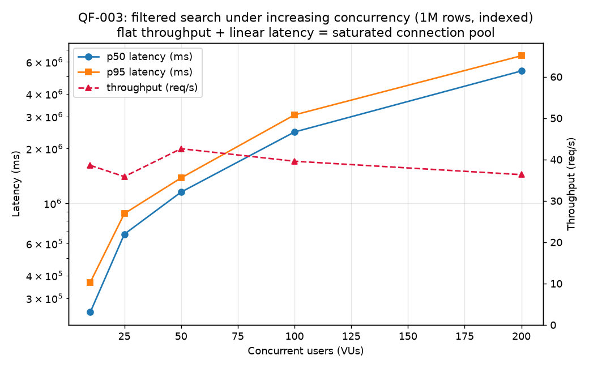

# QueryForge

**PostgreSQL Performance Engineering Service** — build it, measure it, find the bottleneck, fix it, prove it.

A small Spring Boot 4.1.2 / Java 25 REST service over a 1,000,000-row PostgreSQL product catalog,
used to run controlled, reproducible database performance experiments: filtered search, OFFSET vs
keyset pagination, and concurrency behavior — each documented with `EXPLAIN (ANALYZE, BUFFERS)`
before/after evidence.

## What was measured → what changed

| Question | Answer (1M rows, seed=42) |
| --- | --- |
| Baseline filtered search (10 req/s) | p95 **8.18 s** — Parallel Seq Scan, 911K rows filtered away per request |
| After one workload-shaped index | p95 **130 ms** (~63×), p50 **92 ms** (~40×), COUNT 79 ms → 11.4 ms (Index Only Scan) |
| OFFSET pagination, 50K rows deep | p50 **129 ms** |
| Keyset pagination, same depth | p50 **40 ms** — flat across depth |
| Index ordering (QF-004) | Order-first candidate measured **faster on every read** (keyset 24.7 vs 36.2 ms p50 at 50K) — kept as a documented candidate, not applied |
| Concurrency ladder 10→200 VUs | Throughput plateaus at **~38 req/s** (10-connection pool — measured, not guessed) |
| Same code at 10K / 100K / 1M rows | p50 **9.9 ms → 37.2 ms → 3,687 ms** — small-scale numbers are not evidence |
| Point lookup floor (Workload A) | p50 **4.8 ms** at 1M rows via PK index |

Tradeoffs: index adds ~60 MB and write overhead; keyset cannot jump to arbitrary pages and carries
no total count. Full reasoning in [docs/conclusions.md](docs/conclusions.md).

## The headline graph


*Flat throughput with linearly growing latency = saturated connection pool —
the measured "what's next" answer, not a guess. More graphs in the experiment reports:
[QF-000](docs/experiments/QF-000-dataset-scaling.md) · [QF-002](docs/experiments/QF-002-pagination.md).*

## Quick start (Docker-first)

Prerequisites: Docker Desktop (Windows or macOS), or Docker Engine with the Compose plugin (Linux).
This starts the database, API, and browser UI without requiring a host JDK, Node.js, Python, k6,
or Bash.

Copy `.env.example` to `.env` and replace `QF_DB_PASSWORD` with a unique local password before
starting. Compose intentionally has no database-password fallback.

```bash
docker compose --profile app up --build -d --wait
docker compose port frontend 80
```

Compose assigns available host ports dynamically and binds them to loopback. Open the frontend
address printed by `docker compose port frontend 80`; use the same command with `backend 8080` or
`db 5432` to discover the API or database address. The experiment catalog and first-session guide
are available immediately. First boot initializes the product schema (V1); the backend baselines
that existing schema at version 2 and applies the run-store migrations (V3/V4). The optional search
index (V2) remains a separate manual optimization. If you already have a Compose database volume,
safely apply the idempotent product schema before loading data:

```bash
docker compose exec db psql -U queryforge -d queryforge -v ON_ERROR_STOP=1 -f /workspace/db/migrations/V1__create_products.sql
```

To populate PostgreSQL with the deterministic 1M-row dataset from inside a disposable Python
container, run:

```bash
docker compose run --rm data-generator 1000000
docker compose exec db psql -U queryforge -d queryforge -v ON_ERROR_STOP=1 -f /workspace/scripts/load-data.sql
```

The loader truncates and replaces the product dataset. It preserves the manually-applied index
state so baseline and optimized benchmark runs remain reproducible. To call the API directly, use
the host and port reported by `docker compose port backend 8080`:

```bash
curl "http://<backend-host>:<assigned-port>/api/products/1"
curl "http://<backend-host>:<assigned-port>/api/products?category=1&status=ACTIVE&minPrice=100&maxPrice=500&sort=createdAt&dir=desc&page=0&size=50"
curl "http://<backend-host>:<assigned-port>/api/products/keyset?category=1&status=ACTIVE&size=50"
```

Host-based Spring Boot startup binds the API to `127.0.0.1` by default. Compose listens on the
container interface but publishes the API only on host loopback. The command above is the explicit
**development bypass**: it has no authentication and must never be exposed beyond the local
machine. The normal portfolio/demo stack is the authenticated local environment below.

### Authenticated local environment

This stack runs a real Keycloak OIDC login, PostgreSQL, the application, Prometheus,
Alertmanager, and a local-only Mailpit SMTP sink. It requires no cloud account or external
identity/email provider. Ports are loopback-only: UI `8080`, API `8081`, Keycloak is available
through the UI at `/id/`, Mailpit `8025`, and Prometheus `9090` (override with the corresponding
`QF_*_PORT` variables). Keep `QF_WEB_BASE_URL` aligned with `QF_WEB_PORT`; Keycloak uses that
configured origin for its canonical OIDC issuer, redirect, and web-origin allowlists.

```bash
# PowerShell
$env:QF_SPRING_PROFILE = 'local-auth'
$env:QF_OIDC_CLIENT_SECRET_FILE = './secrets/qf_oidc_client_secret.txt'
$env:QF_WEB_BASE_URL = 'http://localhost:8080'
$env:QF_KEYCLOAK_ADMIN = 'qf-admin'
$env:QF_KEYCLOAK_ADMIN_PASSWORD = '<set-a-strong-local-password>'
docker compose --profile app --profile authenticated --profile monitoring up --build -d --wait
```

Before starting the authenticated profile, copy
`secrets/qf_oidc_client_secret.txt.example` to an ignored local secret file and replace the
placeholder with a random URL-safe secret of at least 32 characters. The same file is supplied to
the backend and used to render the Keycloak realm import at startup; its contents are never stored
in the tracked realm template.

Open `http://localhost:8080` and sign in with either local-only account:

| Account | Password | Permission |
| --- | --- | --- |
| `viewer` | `viewer-local-only` | Read results, plans, history, and permitted artifacts |
| `operator` | `operator-local-only` | Viewer permissions plus create, start, cancel, and compare runs |

Set `QF_KEYCLOAK_ADMIN` and `QF_KEYCLOAK_ADMIN_PASSWORD` explicitly; Compose has no bootstrap
administrator defaults.

Verify local operational email by opening `http://localhost:8025`. Alertmanager delivers to that
sink only; a deliberate backend stop produces both a `[FIRING:1]` and a `[RESOLVED]` message, and
both have been observed in this stack. Prometheus targets and alerts are available at
`http://localhost:9090`; `queryforge` (backend) and `postgres` are both scraped.

Signing out ends the application session and clears the CSRF cookie; the Keycloak SSO session is
not ended, so an immediate second sign-in can complete without a password prompt. That is standard
OIDC behavior for this local fixture, not a bypass.

Back up and verify the database without touching the live copy:

```bash
docker compose exec -T db pg_dump -U queryforge -d queryforge -Fc -f /tmp/queryforge.dump
docker compose cp db:/tmp/queryforge.dump ./queryforge-backup.dump
# restore into a scratch database and compare counts (see docs/operations.md)
```

Stop the stack without removing data:

```bash
docker compose --profile app --profile authenticated --profile monitoring down
```

Do not add `-v` unless you intentionally want to delete PostgreSQL, Keycloak, Prometheus, and
Alertmanager data. The separate production-shaped TLS deployment and its external requirements
remain documented in [docs/operations.md](docs/operations.md).

Stop the stack with `docker compose --profile app down`; add `-v` only when you intentionally
want to delete the database volume and its contents. The same Compose commands work in PowerShell,
Command Prompt, macOS Terminal, and Linux shells. Host ports are chosen dynamically by default;
set `QF_WEB_PORT`, `QF_API_PORT`, or `QF_DB_PORT` in a local `.env` file when a stable port is
needed.

### Verification (what is actually green)

```bash
# Backend: 143 tests, including a real postgres:17 container
runmvn.bat -B -ntp clean verify       # Windows; ./mvnw elsewhere

# Frontend: 23 unit tests + production build
cd frontend
npm test
npm run build

# Fixture-backed browser UI (stubs the API; no stack required)
npm run e2e:ci                        # 3 tests

# Real-stack acceptance (the authenticated Compose stack must be running)
QF_REAL_STACK=1 PLAYWRIGHT_BASE_URL=http://localhost:8080 npm run e2e:real   # 9 tests
```

The fixture suite is not evidence of the integrated path. The real-stack suite signs in through
Keycloak, checks viewer/operator authorization and CSRF, starts a real k6 run, watches live SSE
output, cancels a run, opens a run-scoped EXPLAIN plan, compares runs, checks nginx security
headers, and signs out. Latest evidence: `143 backend`, `23 frontend unit`, `3 fixture`,
`9 real-stack`, all passing. See [docs/release-readiness.md](docs/release-readiness.md) for the
full register and limits.

### Host-based benchmark setup

For the full benchmark reproduction scripts, also install JDK 25, Python 3, k6, and Bash (Git Bash
or WSL on Windows). This preserves the directly inspectable baseline/index workflow:

```bash
docker compose up -d db
./scripts/load-data.sh 1000000
mvn spring-boot:run
```

See [scripts/README.md](scripts/README.md) for all benchmark scenarios and platform notes.

Benchmarks (full QF-001/002/003 reproduction, from the repo root):

```bash
./scripts/benchmark.sh search RATE=10 DUR=60s OUT=qf001-baseline-search-1M-r10
./scripts/apply-index.sh
./scripts/benchmark.sh search RATE=10 DUR=60s OUT=qf001-indexed-search-1M-r10
./scripts/benchmark.sh pagination MODE=offset RATE=20 DUR=60s OUT=qf002-offset-1M
./scripts/benchmark.sh pagination MODE=keyset RATE=20 DUR=60s OUT=qf002-keyset-1M
./scripts/benchmark.sh concurrency VUS=100 DUR=45s OUT=qf003-vus100
```

Results land in `benchmark/results/*.json`; plans in `docs/experiments/plans/`.

A lightweight perf-regression check (NFR5) is included:

```bash
./scripts/perf-regression.sh        # fails if filtered-search p95 > 1000 ms (tunable)
```

## API

| Endpoint | Purpose |
| --- | --- |
| `GET /api/products/{id}` | point lookup (404 if missing) |
| `GET /api/products` | filtered search: `category, status, minPrice, maxPrice, sort(createdAt\|price\|id), dir, page, size≤200` |
| `GET /api/products/keyset` | cursor pagination: same filters + `cursor` + `size` (`sort=createdAt` only — the cursor encodes `(created_at, id)`) |
| `GET /api/categories` | category list |

## Documentation map

- [docs/architecture.md](docs/architecture.md) — components and request paths
- [docs/operations.md](docs/operations.md) — local operation, production-shaped deployment controls, and readiness limits
- [docs/benchmarks.md](docs/benchmarks.md) — experiment index, benchmark matrix, reproduction commands
- [docs/experiments/](docs/experiments/) — QF-000 (scaling), QF-001 (index), QF-002 (pagination), QF-003 (concurrency), QF-004 (index ordering), raw plans
- [docs/conclusions.md](docs/conclusions.md) — engineering conclusions, tradeoffs, and the next justified levers

## Design principle

**Never optimize because you know the answer — optimize because the evidence says where the problem
is.** The baseline schema has zero secondary indexes; the composite index is a *measured* change
applied manually via `scripts/apply-index.sh`, never assumed.

## Frontend UI

A lightweight Angular 22 evidence browser lets you inspect experiments, run history, and comparisons without leaving the browser.

Screenshots are generated locally (and are not committed); run `npm run e2e:screenshots` from
`frontend` after starting the backend and preparing run history.

The production build currently emits a **351.99 kB initial bundle** (estimated **96.52 kB
transfer**) with charts and page features split into lazy route chunks. CI enforces an initial
bundle warning at 400 kB and fails above 500 kB; these bundle limits complement, but do not replace,
measured API and PostgreSQL latency checks.

The backend exposes request timing through `/actuator/metrics/http.server.requests` and
Prometheus-compatible histogram buckets through `/actuator/prometheus`, so p95/p99 can be
aggregated over a representative request window instead of inferred from a single maximum.
Legacy benchmark summaries are kept in memory between requests and refreshed from disk every
two seconds, avoiding repeated JSON parsing while keeping externally written result files visible.

### Reproducible result story

1. Start the backend (`mvn spring-boot:run`). From this checkout's `frontend` directory, start the UI with `npm start -- --host 127.0.0.1 --port 4201`.
2. Open `http://127.0.0.1:4201` — the overview shows API/DB/k6 health and the latest benchmark run. Using a dedicated port helps avoid accidentally viewing a dev server from another worktree.
3. Browse **Catalog** to see experiment templates (QF-000 through QF-004).
4. Launch a run or inspect existing ones in **Run history**; each run detail shows latency percentiles, throughput, hints, and downloadable artifacts (`k6-summary`, `explain-plan`). Explain-plan artifacts link to **View plan**, which renders the parsed plan tree.
5. Use **Compare** to pick two runs and get a compatibility verdict, warning/blocker list, and a
   grouped metric-delta table (baseline vs candidate, absolute change and percentage, colour-coded
   as improvement or regression).
6. The full browser smoke flow covers catalog → run → detail → compare → artifact download → keyboard navigation.

## Test

```bash
mvn test                                      # unit + functional tests, plus real postgres:17 coverage when Docker is up
npm --prefix frontend run build               # Angular production build
npm --prefix frontend run build:analyze       # build + browser-stats.json for esbuild bundle analysis
```

The bundle analysis file is `frontend/dist/frontend/browser-stats.json` and can be opened with
[esbuild's bundle analyzer](https://esbuild.github.io/analyze/). Production bundle budgets are
enforced by `frontend/angular.json` and the same analysis artifact is uploaded by CI.

> **Docker note:** `PostgresIntegrationSmokeTest` starts `postgres:17` through Testcontainers and is
> skipped automatically when no Docker daemon is reachable. `pom.xml` pins the engine API version
> (`api.version=1.44`) because Docker Engine 25+ rejects the older client version Testcontainers
> still defaults to.

> **Windows note:** if Testcontainers cannot reach Docker Desktop's named pipes from the Java
> client, run the functional suite against the compose database instead:
> Pin `QF_DB_PORT=5433` in `.env`, restart Compose, then run
> `QF_DB_URL=jdbc:postgresql://localhost:5433/queryforge mvn test`.

> **Local database password:** Set `QF_DB_PASSWORD` explicitly before starting Compose. The
> configuration has no database-password fallback.

Playwright starts the frontend from this checkout automatically. If port `4200` is occupied, set
`PLAYWRIGHT_PORT` to a free port. To test an already running app (including Docker Compose's
dynamically assigned frontend port), set `PLAYWRIGHT_BASE_URL` to that app's URL; Playwright then
uses the existing app without starting a second frontend server.
The deterministic first-session suite runs without a backend using `npm run e2e:ci`; it stubs the
API and is the browser flow exercised in CI. The Docker backend image bundles k6 and the
experiment scripts; local `mvn spring-boot:run` needs k6 available on `PATH` or configured with
`K6_PATH`/`K6_BIN`.
